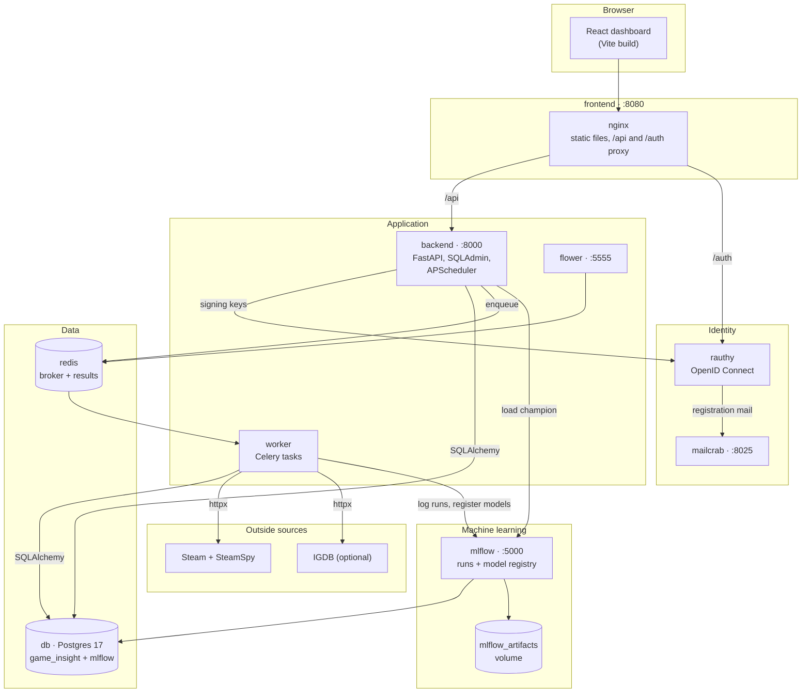
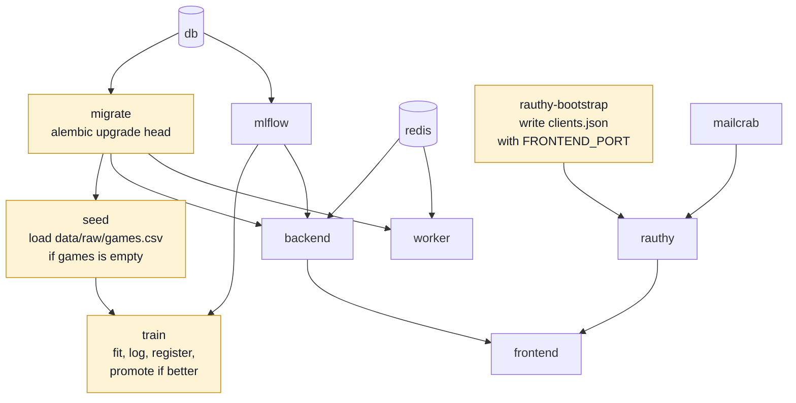
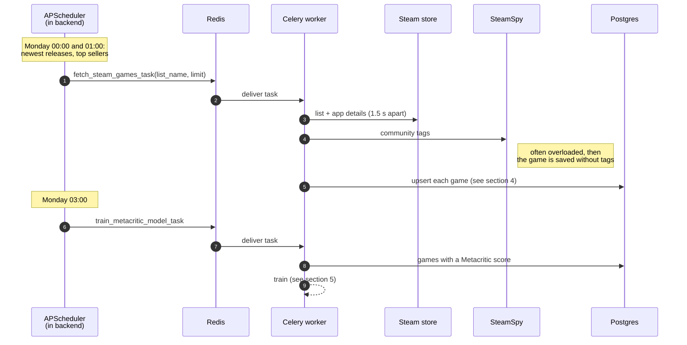
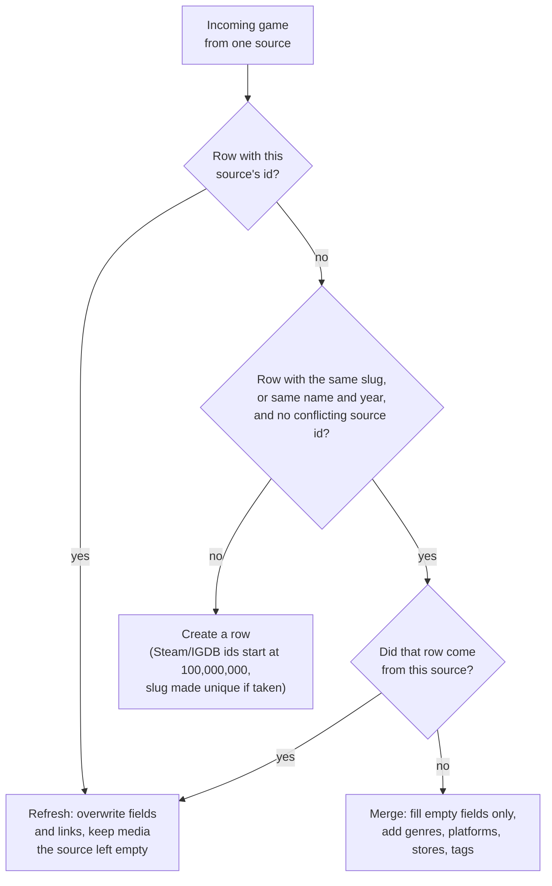
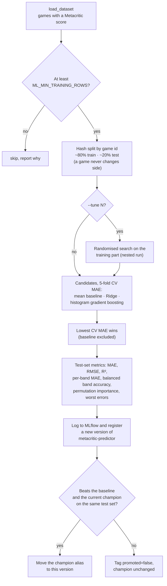
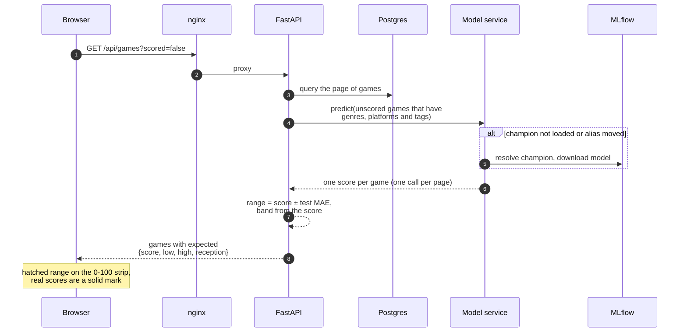
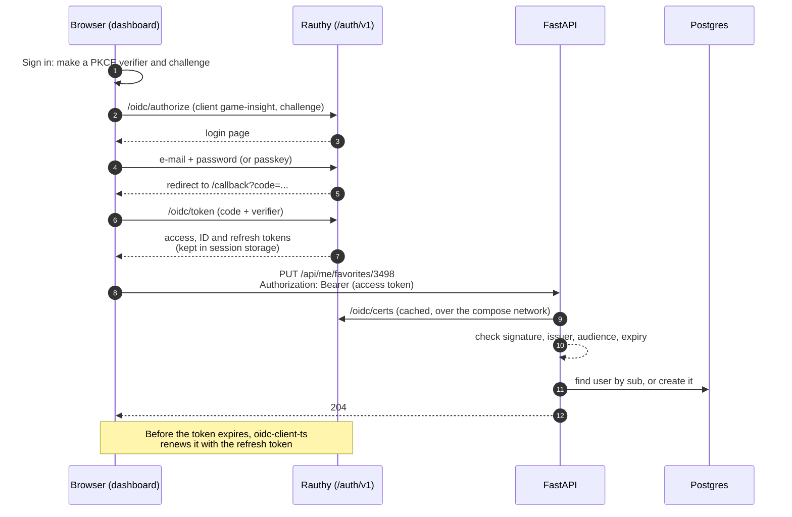
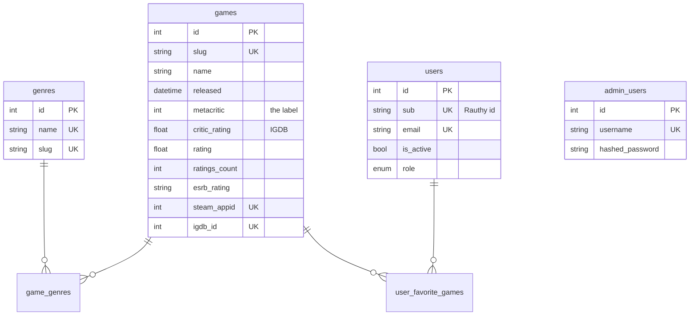
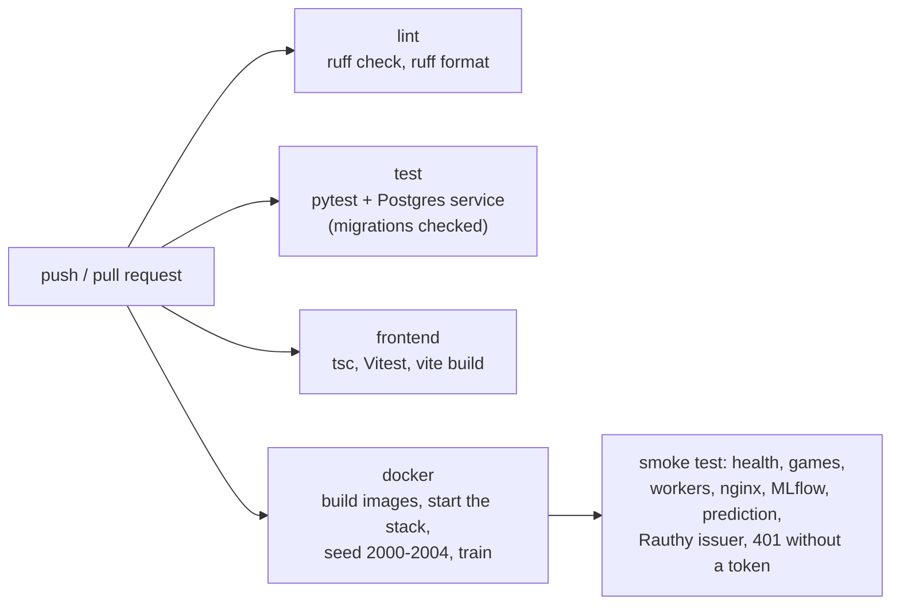

# How Game Insight works

This page follows the system from the outside in: what runs where, how the stack
starts, how games get into the database, how the model is trained and served, how a page
of the dashboard is put together, and how sign-in works. The diagrams are Mermaid and
render on GitHub. Names in `code` are the real services, files and functions.

- [1. The pieces](#1-the-pieces)
- [2. Starting the stack](#2-starting-the-stack)
- [3. Getting games in](#3-getting-games-in)
- [4. One game, several sources](#4-one-game-several-sources)
- [5. Training a model](#5-training-a-model)
- [6. Serving estimates in the product](#6-serving-estimates-in-the-product)
- [7. Signing in](#7-signing-in)
- [8. The database](#8-the-database)
- [9. Tests and CI](#9-tests-and-ci)

## 1. The pieces

Everything runs in Docker Compose (`compose.yaml`). The browser only ever talks to the
dashboard's nginx on one origin; nginx forwards `/api` to FastAPI and `/auth` to Rauthy.
Ports are the defaults on the host.

| Piece | Code | Job |
| --- | --- | --- |
| Dashboard | `frontend/src` | Browse games, read estimates, save favourites, estimate an unreleased game. |
| API | `src/backend/main.py` | Games, stats, predictions, favourites, task management, admin panel. |
| Scheduler | `src/backend/task_scheduler.py` | Runs inside the API process and puts periodic jobs on the Celery queue. |
| Worker | `src/worker/tasks.py`, `src/worker/sources/` | Fetches games from Steam, SteamSpy and IGDB; trains the model on schedule. |
| Model code | `src/ml/` | Features, training with MLflow, loading the champion for the API. |
| Identity | Rauthy, `deploy/rauthy/clients.json`, `src/backend/auth.py` | Accounts, sign-in, registration; the API checks its tokens. |

## 2. Starting the stack

`docker compose up --build` brings everything up in dependency order. Four services are
one-shots: they do one job and exit, and the services after them wait for success.

On a second start the one-shots run again but find nothing to do: migrations are
applied, the `games` table is not empty, and a retrained model on unchanged data is
registered but not promoted. Rauthy reads its bootstrap files only when its own
database is empty.

## 3. Getting games in

There are three ways in. The bundled CSV snapshot seeds an empty database. Scheduled
jobs fetch new games every week (Steam) and month (IGDB). Any job can also be run by
hand from `/task-management`.

| Job | When | Needs |
| --- | --- | --- |
| Steam newest releases, top sellers | Mondays 00:00, 01:00 | nothing |
| Retrain the model | Mondays 03:00 | nothing |
| IGDB last month's releases | 1st of the month, 00:30 | `IGDB_CLIENT_ID`, `IGDB_CLIENT_SECRET` |
| RAWG weekly and monthly updates | Mondays, 1st of the month | `RAWG_API_KEY` (the API was down when tested) |

Schedules live in memory, so changes made in the task manager last until the backend
restarts.

## 4. One game, several sources

The same game can arrive from the CSV snapshot, Steam and IGDB. `crud.upsert_game`
decides whether a game is new, a refresh, or extra detail for a game already stored.

One source never overwrites another. Two rows that each hold a different id from the
same source are never merged, even when the names match.

## 5. Training a model

`python -m src.ml.train` (the `train` service, the weekly job, or by hand) trains on
every game that has a Metacritic score. Its inputs are things known before reviews come
in: title, release date, ESRB rating, genres, platforms, stores and tags.

The current champion is re-scored on the same test games before the comparison, so a
version trained on more data is not compared against an old, easier test set.

## 6. Serving estimates in the product

The API never ships a model file of its own. It asks MLflow for
`models:/metacritic-predictor@champion` on first use and re-checks the alias every
`MODEL_REFRESH_SECONDS` (60 by default), so a newly promoted version goes live without a
restart.

This is what happens when the home page asks for recent games critics never scored:

Without a champion, lists load without estimates and the prediction endpoints answer
503. The game page asks `/api/games/{id}/predicted-metacritic` for the same estimate. For
a scored game it shows how the real score compares with what the model would have
expected.

## 7. Signing in

Accounts live in Rauthy; the app stores no passwords. The dashboard uses the
authorization code flow with PKCE (`oidc-client-ts`), and the API checks every access
token itself.

The issuer the API expects (`OIDC_ISSUER`) is the address the browser sees,
`http://localhost:<FRONTEND_PORT>/auth/v1/`. The keys come from Rauthy directly
(`OIDC_JWKS_URL`). A user from before Rauthy is linked to the account that brings the same
verified e-mail address. Registration and password-reset mail goes to mailcrab, so
nothing leaves the machine.

## 8. The database

Alembic migrations in `src/backend/alembic/versions` build this schema;
`tests/test_migrations.py` fails CI if the migrations and `models.py` disagree. MLflow
keeps its own tables in a separate `mlflow` database on the same server.

`platforms`, `stores` and `tags` have the same shape as `genres` and link to `games`
the same way (`game_platforms`, `game_stores`, `game_tags`). Game ids are RAWG's ids, or
100,000,000 and up for rows first created from Steam or IGDB. `metacritic` is the
training label; `critic_rating` holds IGDB's critic average and is never used as one.
`admin_users` are separate from dashboard accounts: they sign in to the SQLAdmin panel
at `/admin`.

## 9. Tests and CI

The Python tests mock every outside HTTP call and train real models against a
throwaway MLflow, so they need no network. Token checks are tested with tokens signed by a
throwaway RSA key (expired, wrong audience, wrong issuer, forged).
